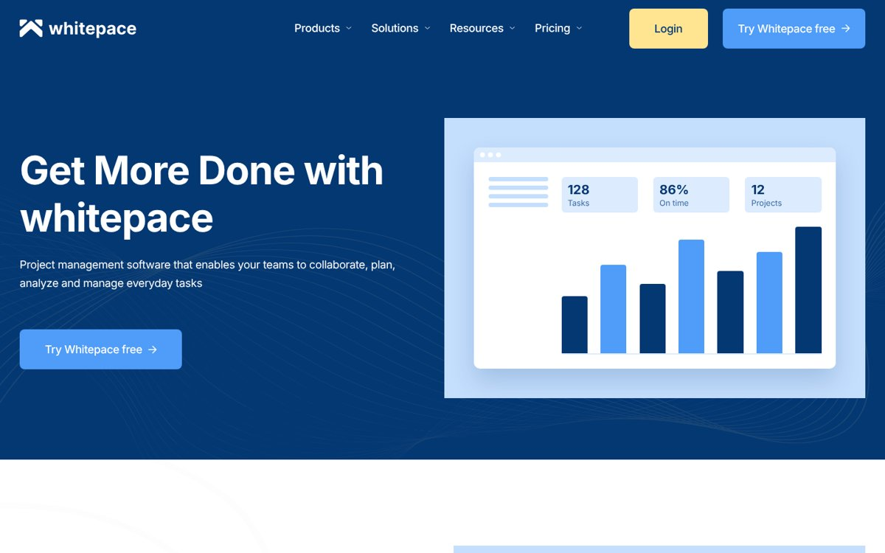
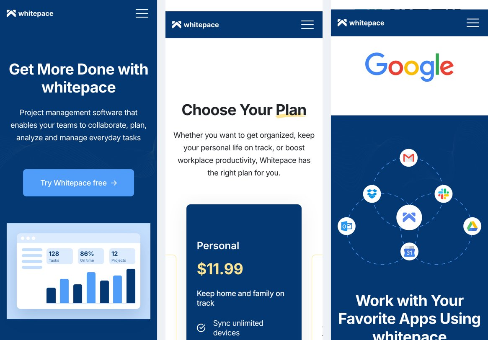
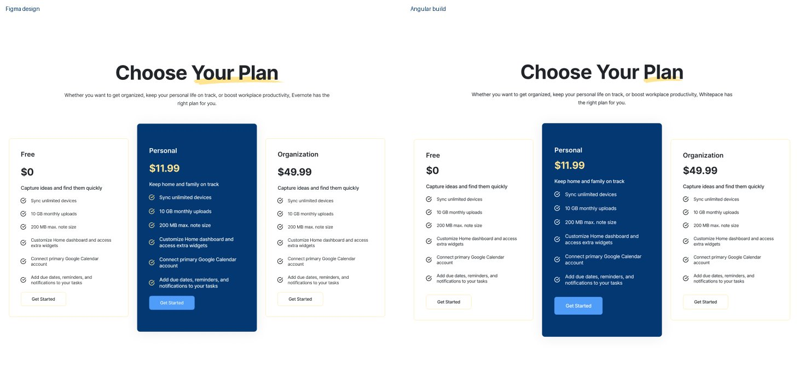

# Figma to Angular: Whitepace landing page

The **Whitepace SaaS landing page** from Figma Community, built in **Angular 22** for desktop, tablet and mobile.

**[Live demo](https://raven737.github.io/figma-to-angular-landing/)** · [Figma design](https://www.figma.com/community/file/1156860863353724933/whitepace-saas-landing-page)





## Design vs build



## Result

| | |
|---|---|
| Lighthouse, mobile | Performance **96** · Accessibility **96** · Best practices **100** · SEO **100** |
| Lighthouse, desktop | Performance **100** · Accessibility **96** · Best practices **100** · SEO **100** |
| JavaScript, initial load | **51 kB** transferred |
| Layout shift (CLS) | **0** |
| All graphics | **195 kB** (exported from Figma: 3.5 MB) |
| Breakpoints | 320, 768 and 1152+ px, as in the design frames |

## How the design was turned into code

- **Design tokens.** Colour and text styles from the Figma file became CSS custom properties and Sass mixins (`src/styles`). Font sizes and spacing change per breakpoint in one place.
- **Components.** 13 Figma sections became 9 section components plus 3 shared UI components. One reusable `app-feature` component with content projection renders six of them.
- **Carousel.** Pricing and testimonials are a grid on desktop and a swipeable carousel with dots on mobile and tablet (CSS scroll snap + signals).
- **Assets.** Exported from Figma, SVGs optimized with SVGO, photos converted to WebP. The 26 brush underlines (88 kB each as SVG) became one 6 kB image reused by every heading.
- **Fonts.** Inter is self-hosted as a variable font: no requests to third-party servers.
- **Accessibility.** Semantic landmarks, skip link, keyboard-friendly menu (Escape closes it), `aria-expanded` and `aria-current`, visible focus, reduced motion support.
- **Angular.** Standalone components, signals, zoneless change detection, `NgOptimizedImage` with lazy loading, unit tests with Vitest.

## Where the build differs from the design, and why

- **Empty image areas.** The image blocks in the community file are blue placeholders, so they are filled with light product mockups made in HTML and CSS (no extra downloads).
- **Copy fixes.** The design text mentions other products and has typos ("Taskey", "Evernote", "Whitepate", "Clients Says", "$11.2" on mobile). Fixed to match the product.
- **One font.** A few elements in the design use DM Sans or Montserrat. Everything uses Inter to save a font download.
- **Slider dots on desktop** are hidden because all three testimonials are already visible.
- **Contrast.** White text on the design's `#4F9CF9` buttons has a 2.8:1 contrast, below WCAG AA. The colour is kept as designed, and changing the `--btn-bg` token to `#3568A6` (from the same palette) fixes it in one line.

## Project structure

```
src/styles/_tokens.scss   breakpoints and mixins
src/styles.scss           colour, typography and spacing tokens
src/app/ui/               button, carousel, product mockups
src/app/sections/         header, hero, feature, pricing, testimonials, footer...
src/app/app.html          the page assembled from sections
```

## Run locally

```bash
npm install
npm start        # http://localhost:4200
npm test
npm run build
```

## Credits

Design: [Whitepace - SaaS Landing Page](https://www.figma.com/community/file/1156860863353724933/whitepace-saas-landing-page) by Al Razi Siam, licensed under [CC BY 4.0](https://creativecommons.org/licenses/by/4.0/). Graphics and photos come from the design file. Brand logos belong to their owners and are shown as in the original design.

## Have a design to build?

I turn Figma designs into Angular apps, fix performance problems and upgrade Angular versions: https://www.fiverr.com/roman_dev777
